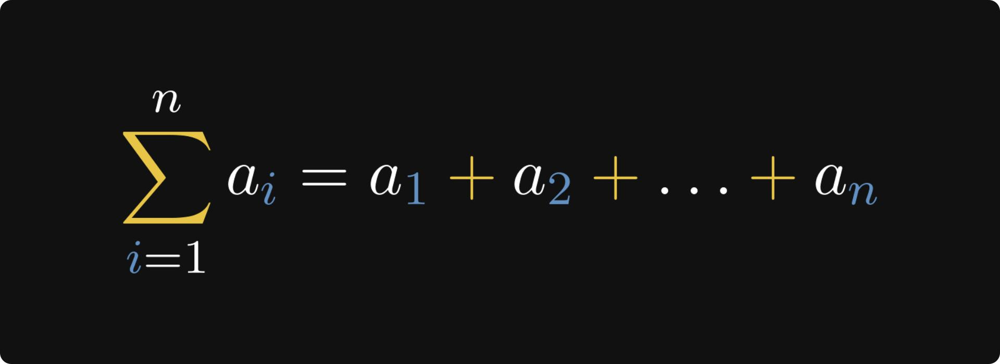

# suma-lab-discrete-math
Academic project developed by 3rd cycle Computer Engineering students at Universidad Peruana Cayetano Heredia (UPCH), for the Discrete Structures I course. SUMA Lab v3 is an educational web simulator focused on summation identities, geometric progressions, and mathematical induction, applied to temporary IP blocking policies.

# 🧮 SUMA Lab v3 

### Educational Simulator for Summation Identities and Mathematical Induction

