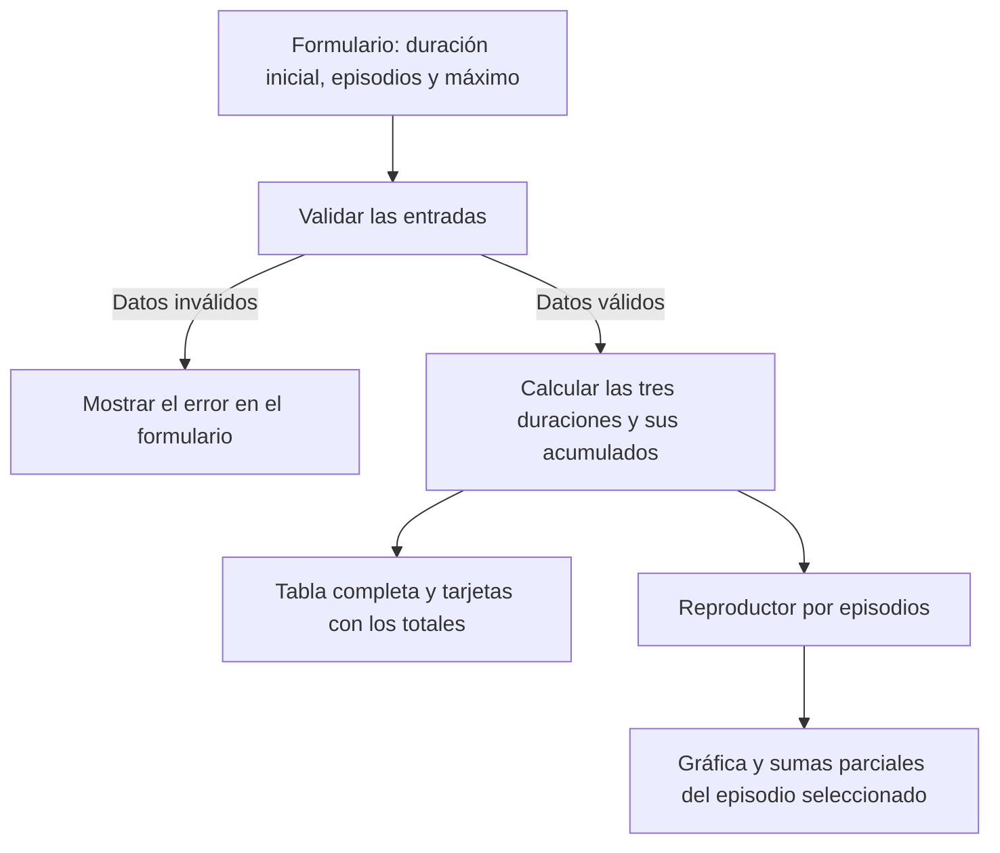

# IV. Objetivos

## 4.1. Objetivo general

Diseñar un simulador web pedagógico dirigido a estudiantes de Ingeniería
Informática que permita comparar el tiempo acumulado de bloqueo de una
dirección IP bajo tres políticas temporales: duración fija, duplicación
progresiva y duplicación con un máximo por episodio. Mediante tablas,
gráficas y una demostración guiada por inducción matemática, el estudiante
podrá relacionar la duración de cada episodio con un término de la
sumatoria y explicar por qué, en la política de duplicación sin tope,
el tiempo acumulado después de $n$ episodios es $b(2^n-1)$, donde $b$
es la duración inicial.

## 4.2. Objetivos específicos

1. **Modelar y comparar las tres políticas de bloqueo.** Representar la
   duración de cada episodio y calcular el tiempo acumulado bajo las tres
   políticas, utilizando la misma duración inicial y el mismo número de
   episodios. En la política con tope, distinguir el primer episodio que
   alcanza la duración máxima del primero en que el límite reduce la
   duración que habría producido la duplicación.

2. **Demostrar por inducción matemática la identidad de la sumatoria
   geométrica.** Guiar al estudiante en la demostración de la igualdad
   $\sum_{i=1}^{n} b\,2^{i-1}=b(2^n-1)$ para todo entero $n\geq 1$.
   Relacionar el caso base con el primer bloqueo, que dura $b$ minutos,
   y el paso inductivo con la incorporación del episodio $k+1$, que añade
   $b\,2^k$ minutos al tiempo acumulado tras $k$ episodios.

3. **Verificar los resultados del simulador.** Contrastar las duraciones
   individuales y los tiempos acumulados con valores obtenidos de forma
   independiente a partir del modelo matemático. Incluir un solo episodio,
   varios episodios sin recorte y un escenario en el que el máximo reduzca
   la duración de un bloqueo. Para la política de duplicación sin tope,
   comprobar que la suma directa de las duraciones coincida con el valor
   calculado mediante la identidad demostrada.
# V. Metodología y diseño

## 5.1. Enfoque y alcance de la simulación

SUMA Lab v3 emplea una simulación discreta y determinista dirigida a estudiantes de Ingeniería Informática. Cada episodio representa un bloqueo temporal de una dirección IP ficticia. El tiempo acumulado se obtiene sumando los minutos de bloqueo de cada episodio. Por ejemplo, si una dirección permanece bloqueada durante dos minutos en el primer episodio y cuatro en el segundo, el acumulado es de seis minutos, independientemente del intervalo transcurrido entre ambos.

El trabajo se organizó en tres etapas. Primero se formularon las reglas de duración de las tres políticas. Luego se diseñó una actividad en la que el estudiante relaciona cada episodio con un término de la sumatoria. Finalmente, se contrastaron los acumulados calculados por el simulador con los resultados esperados del modelo matemático.

## 5.2. Datos de entrada y condiciones de comparación

| Símbolo | Dato de entrada | Valores admitidos |
| --- | --- | --- |
| $b$ | Duración inicial del bloqueo | De 0,01 a 10 000 minutos, con hasta dos decimales |
| $n$ | Número de episodios | Entero entre 1 y 30 |
| $M$ | Duración máxima por episodio en la política con tope | De $b$ a 10 000 minutos, con hasta dos decimales |

Las tres políticas se comparan con la misma duración inicial y el mismo número de episodios. De esta manera, las diferencias observadas en la tabla y la gráfica se explican por la regla de duración aplicada. El parámetro $M$ interviene únicamente en la política con tope.

El simulador acepta coma o punto decimal y convierte las duraciones a centésimas enteras de minuto antes de operar. Así, una entrada de `0,50` minutos se representa internamente como `50` centésimas. Los resultados se presentan al estudiante en minutos.

## 5.3. Modelo matemático de las políticas de bloqueo

Sea $d_i$ la duración del episodio $i$. Después de $n$ episodios, el tiempo acumulado es la suma de sus duraciones:

$$
T(n)=\sum_{i=1}^{n}d_i
$$

**Tabla I. Duración individual y tiempo acumulado según la política de bloqueo**

| Política | Duración del episodio $i$ | Tiempo acumulado tras $n$ episodios |
| --- | --- | --- |
| Fija | $d_i=b$ | $T_f(n)=nb$ |
| Progresiva por duplicación | $d_i=b\,2^{i-1}$ | $T_p(n)=b(2^n-1)$ |
| Progresiva con tope | $d_i=\min(b\,2^{i-1},M)$ | $T_M(n)=\sum_{i=1}^{n}\min(b\,2^{i-1},M)$ |

En la política progresiva, el exponente $i-1$ indica cuántas duplicaciones han ocurrido desde el primer bloqueo. Por eso, las primeras duraciones son $b$, $2b$, $4b$ y $8b$.

En la política limitada, el máximo se aplica a cada episodio antes de incorporarlo a la suma. Por ejemplo, con $b=1$ y $M=4$, las duraciones son 1, 2, 4 y 4 minutos. El tercer episodio **alcanza el máximo** exactamente. El cuarto es el primero en que **se recorta la duración**, porque le habrían correspondido 8 minutos. El acumulado llega a 11 minutos aunque cada bloqueo individual dura como máximo 4.

## 5.4. Diseño del algoritmo y herramientas elegidas

El simulador utiliza HTML para organizar las vistas, CSS para su presentación y JavaScript para calcular y mostrar los resultados en el navegador [12]. La versión editable separa la interfaz (`index.html` y `style.css`), el modelo matemático (`model.mjs`) y la interacción con el estudiante (`app.mjs`). Así, las pruebas pueden ejecutarse sobre el mismo módulo de cálculo que utiliza la interfaz. Para el uso en clase, `Simulador_EDI.html` reúne los componentes en un archivo que se abre sin conexión.

El algoritmo guarda una fila por episodio. Cada fila contiene las tres duraciones individuales y sus respectivos acumulados. Estos mismos datos alimentan la tabla, la gráfica y el reproductor de episodios.

```text
INICIO
  Leer la duración inicial b, el número de episodios n y el máximo M
  Validar los rangos y la precisión indicados en el apartado 5.2
  Si alguna entrada es inválida:
      Mostrar el error y terminar el cálculo actual

  Convertir b y M a centésimas enteras de minuto
  TotalFijo ← 0
  TotalProgresivo ← 0
  TotalConTope ← 0

  Para i desde 1 hasta n:
      Fija ← b
      Progresiva ← b × 2^(i − 1)
      ConTope ← mínimo(Progresiva, M)

      TotalFijo ← TotalFijo + Fija
      TotalProgresivo ← TotalProgresivo + Progresiva
      TotalConTope ← TotalConTope + ConTope

      Guardar i, las tres duraciones y los tres acumulados
  FinPara

  TotalTeórico ← b × (2^n − 1)
  Comparar TotalProgresivo con TotalTeórico
  Identificar, si existe, el primer episodio con ConTope = M
  Identificar, si existe, el primer episodio con Progresiva > M
  Mostrar la tabla en minutos y la gráfica hasta el episodio seleccionado
FIN
```

## 5.5. Diseño de la actividad pedagógica

En «Empieza aquí», el estudiante observa siete bloqueos sucesivos con una duración inicial de un minuto. El séptimo bloqueo dura 64 minutos y el tiempo acumulado llega a 127 minutos. La actividad comienza con esta distinción porque el paso inductivo exige reconocer qué cantidad ya está acumulada y qué término se incorpora a continuación.

En «Inducción guiada» se trabaja con $b=1$, $n=4$ y $M=5$. Después de los tres primeros episodios, las dos políticas progresivas acumulan $1+2+4=7$ minutos. Antes de mostrar el cuarto episodio, se pide al estudiante predecir cuánto se añadirá. Sin tope se añaden 8 minutos y el total llega a 15. Con tope se añaden 5 minutos y el total llega a 12.

A partir de esa predicción se construye la demostración de la identidad de la política progresiva sin tope:

1. **Caso base.** Para $n=1$, el único bloqueo dura $b$ minutos. La fórmula produce el mismo valor: $T_p(1)=b(2^1-1)=b$.
2. **Hipótesis inductiva.** Para un entero arbitrario $k\geq 1$, se supone que los primeros $k$ episodios acumulan $T_p(k)=b(2^k-1)$.
3. **Paso inductivo.** El episodio $k+1$ aporta $b\,2^k$ minutos. Al añadirlo al acumulado anterior se obtiene:

$$
T_p(k+1)=b(2^k-1)+b\,2^k=b(2^{k+1}-1)
$$

Por inducción matemática, la identidad se cumple para todo entero $n\geq 1$. La actividad pide al estudiante elegir el nuevo sumando y le ofrece retroalimentación sobre su elección, en línea con la participación activa en la visualización de programas descrita por Sorva, Karavirta y Malmi [13].

## 5.6. Diseño de la verificación

La verificación comprueba que el programa ejecute las reglas del modelo, siguiendo la distinción metodológica de Sargent [14]. Se seleccionaron casos que permiten identificar errores concretos: un solo episodio para revisar la inicialización, un máximo igual a la duración inicial, un máximo que recorta un bloqueo y una duración decimal. También se probaron entradas inválidas, como una cantidad fraccionaria de episodios o un máximo inferior a la duración inicial.

El verificador combina cuatro duraciones iniciales, seis factores para calcular el máximo y los treinta valores admitidos de $n$. El barrido comprende **720 ejecuciones, 11 160 filas y 33 480 comparaciones**, una por política en cada fila. El criterio de aceptación es la coincidencia exacta en centésimas de minuto.

Para el episodio $i$, los valores de referencia son $bi$ en la política fija y $b(2^i-1)$ en la progresiva. Para la política con tope, $q$ representa la cantidad de episodios, entre los primeros $i$, cuya duración progresiva es menor o igual que $M$. Los primeros $q$ términos conservan su duración geométrica y cada uno de los $i-q$ restantes aporta $M$. Por tanto, el acumulado esperado es:

$$
T_M(i)=b(2^q-1)+(i-q)M
$$

El verificador evalúa estas expresiones con enteros `BigInt` y las contrasta con la suma obtenida fila por fila. El resultado permite evaluar la corrección de los cálculos. Determinar cuánto aprenden los estudiantes al usar el simulador requeriría una evaluación con participantes.
# VI. Implementación o simulación

## 6.1. Arquitectura del simulador

SUMA Lab v3 representa los bloqueos temporales sucesivos de una dirección IP ficticia. El estudiante introduce la duración inicial del bloqueo ($b$), el número de episodios ($n$) y la duración máxima por episodio ($M$). A partir de esas entradas, el simulador calcula y compara tres políticas: duración fija, duplicación progresiva y duplicación con tope.

La versión editable distribuye el trabajo entre dos módulos. `model.mjs` valida las entradas, convierte las duraciones a centésimas de minuto y calcula las filas de resultados. `app.mjs` utiliza esas mismas filas para construir la tabla, actualizar las tarjetas y reproducir la gráfica episodio por episodio. Esta organización permite probar las operaciones matemáticas independientemente de la interfaz.

**Esquema VI.1. Recorrido de los datos desde el formulario hasta las salidas de SUMA Lab v3**



Las tarjetas muestran los totales del escenario completo. Al detener el reproductor en un episodio intermedio, la gráfica y las sumas parciales permiten observar cómo se llegó a esos totales. El estudiante puede detenerse en el tercer episodio, predecir el siguiente sumando y comprobar su respuesta al avanzar.

## 6.2. Fragmento esencial de código

La función `simularBloqueos`, definida en `model.mjs`, recibe las entradas ya validadas. Los parámetros `b` y `M` se expresan en centésimas de minuto y `n` indica la cantidad de episodios. En cada iteración se guarda una fila con el número de episodio, las tres duraciones individuales y los tres tiempos acumulados.

```javascript
export function simularBloqueos(b, n, M) {
  let f = 0, p = 0, t = 0;
  const filas = [];

  for (let i = 1; i <= n; i++) {
    const d = b * 2 ** (i - 1);
    const c = Math.min(d, M);

    f += b;
    p += d;
    t += c;

    filas.push([i, b, d, c, f, p, t]);
  }

  return {
    filas,
    teorico: b * (2 ** n - 1),
    alcanza: filas.find(r => r[3] === M)?.[0] ?? null,
    recorta: filas.find(r => r[2] > M)?.[0] ?? null
  };
}
```

La instrucción `p += d` implementa la sumatoria progresiva: añade la duración del episodio actual al tiempo acumulado hasta el episodio anterior. Por su parte, `t += c` incorpora la duración después de aplicar el tope. El campo `teorico` calcula $b(2^n-1)$ para contrastar la suma obtenida por iteración con la identidad geométrica.

Los campos `alcanza` y `recorta` distinguen dos situaciones. `alcanza` identifica el primer episodio cuya duración limitada es igual a $M$. `recorta` identifica el primero cuya duración progresiva habría superado $M$. Si la situación correspondiente no ocurre, el campo devuelve `null`.

Por ejemplo, para representar **1 minuto inicial, 4 episodios y un máximo de 5 minutos**, la llamada al módulo utiliza `simularBloqueos(100, 4, 500)`. Su última fila es:

```text
[4, 100, 800, 500, 400, 1500, 1200]
```

El primer valor identifica el cuarto episodio. Los tres siguientes indican que ese bloqueo dura **1, 8 y 5 minutos**, respectivamente. Los tres últimos representan los **acumulados de 4, 15 y 12 minutos** que muestra la interfaz.

## 6.3. Procedimiento de reproducción

1. Extraer el paquete del simulador y abrir `Simulador_EDI.html` en un navegador. En la sección **Empieza aquí**, observar la secuencia de siete bloqueos por duplicación. El séptimo bloqueo dura 64 minutos y el tiempo acumulado llega a 127 minutos.

2. Entrar en **Simulador** e introducir $b=1$ minuto, $n=4$ episodios y $M=5$ minutos. Pulsar **Comparar políticas**, reiniciar el reproductor y avanzar hasta el tercer episodio. Las políticas progresiva y con tope llevan el mismo acumulado: $1+2+4=7$ minutos.

3. Antes de avanzar, predecir cuánto añadirá el cuarto bloqueo. Al reproducirlo, la política progresiva suma 8 minutos y llega a 15. La política con tope suma 5 minutos y llega a 12. Los 3 minutos de diferencia entre los acumulados proceden del recorte aplicado a ese cuarto episodio.

4. Abrir **Inducción guiada** y pasar del ejemplo al caso general. El primer episodio cumple $T_p(1)=b$. Si los primeros $k$ episodios acumulan $b(2^k-1)$, el episodio $k+1$ aporta $b\,2^k$. Al elegir ese término se completa el paso inductivo:

$$
T_p(k+1)=b(2^k-1)+b\,2^k=b(2^{k+1}-1).
$$

## 6.4. Casos normales y casos límite

En cada ensayo se utilizaron las mismas entradas para las tres políticas. La tabla presenta cinco casos del verificador. Los resultados corresponden al **tiempo acumulado al finalizar el último episodio**, expresado en minutos.

**Tabla VI.1. Acumulados por política en cinco escenarios de prueba**

| Caso | Duración inicial $b$ (min) | Episodios $n$ | Máximo $M$ (min) | Fija (min) | Progresiva (min) | Con tope (min) |
| --- | ---: | ---: | ---: | ---: | ---: | ---: |
| Escenario principal | 1 | 4 | 5 | 4 | 15 | 12 |
| Un solo episodio | 1 | 1 | 5 | 1 | 1 | 1 |
| Máximo igual a la duración inicial | 2 | 4 | 2 | 8 | 30 | 8 |
| Duración decimal | 0,5 | 3 | 1 | 1,5 | 3,5 | 2,5 |
| Máximo alcanzado exactamente | 1 | 4 | 4 | 4 | 15 | 11 |

El último caso muestra por qué se registran por separado el primer alcance y el primer recorte. En el tercer episodio, la duración prevista es de 4 minutos y coincide con el máximo. En el cuarto, la duplicación produciría 8 minutos y el simulador aplica el límite de 4. Por eso, la secuencia limitada es $1,2,4,4$ y su acumulado es **11 minutos**.

## 6.5. Evidencias de ejecución y registro

Las pruebas automatizadas se ejecutan desde la carpeta `codigo` con el siguiente comando:

```bash
node tests/verify.mjs
```

La ejecución reprodujo los resultados registrados en `tests/verification-results.json`. Los **siete escenarios válidos** coincidieron con los totales esperados y el validador identificó las **seis entradas inválidas**. Entre ellas se encontraban una duración inicial de cero, una cantidad fraccionaria de episodios y un máximo inferior a la duración inicial.

El barrido automatizado completó **720 ejecuciones** y generó **11 160 filas**. En cada fila se contrastaron los tres acumulados con valores calculados de forma independiente, lo que produjo **33 480 comparaciones sin discrepancias**. Las pruebas respaldan el cálculo del programa en los escenarios evaluados. La demostración por inducción justifica la identidad geométrica para cualquier número entero positivo de episodios.

Para conservar la evidencia de un escenario desde la interfaz, se selecciona el último episodio del reproductor y se abre **Resultados y pruebas**. El archivo **CSV** guarda las filas de la tabla y el **SVG** conserva la gráfica hasta el episodio seleccionado. Al ejecutar la verificación antes de exportar el **JSON**, también quedan registrados los resultados de las pruebas.
